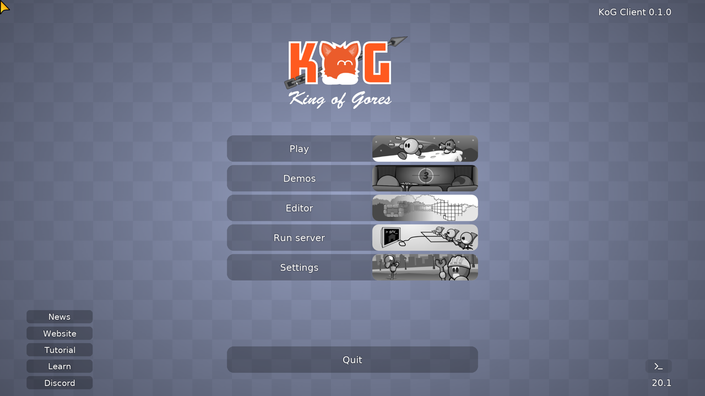
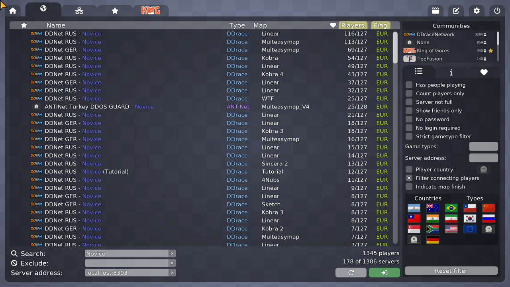
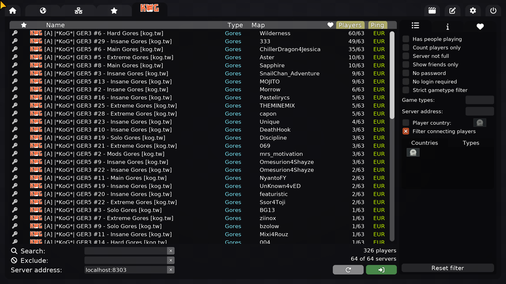
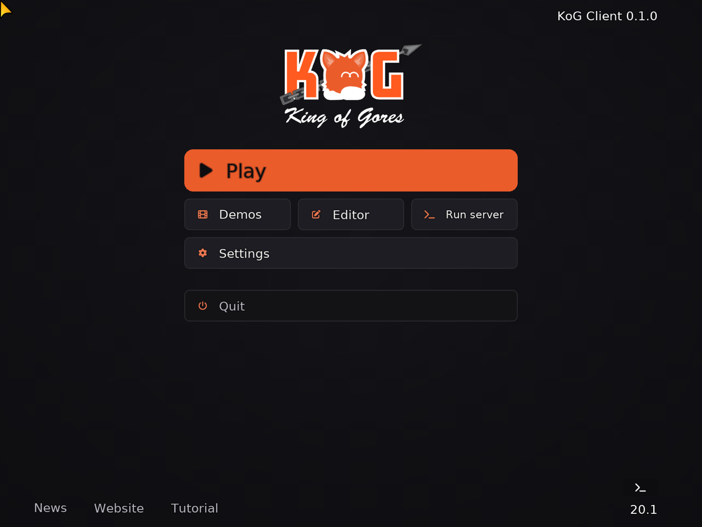

# Client style: one design system, kept in one place

Status: tokens, theme switch, start page and quest card are built (this series). The rest is listed in section 9.
Code: `src/game/client/kog_style.h` (the numbers, no configuration, tested) and `src/game/client/kog_theme.h` (the switch).
Test: `src/test/kog_style_test.cpp` (contrast, scales, status colours).

## 1. Principles

1. **One place.** Every colour, spacing, radius, size and timing of the KoG look is in `kog_style.h`. New UI code reads
   `KogStyle::` names; a bare number for a colour or a gap in a new file is a review finding.
2. **Safe fallback.** `cl_kog_theme` 0 is Classic: every shared file asks `KogTheme::On()` or a helper and gets exactly
   the value it used before. 1 is the KoG dark look. It is a player preference (a checkbox in Settings, Graphics), not a
   feature flag; default is on.
3. **Cheap merges.** New code lives in `components/kog/` and `kog_*`. The upstream files change by a few lines at the
   places where a colour is chosen (`ui.cpp`, `ui_listbox.cpp`, `menus.cpp`, `menus_start.cpp`): about 40 lines.
4. **No new cost per frame.** Quads and text only; no blur, no render target. The theme is read as one integer.
5. **Accessible.** Contrast is a unit test, status never relies on colour alone, text is never below 12 units.

## 2. Tokens (dark)

| Token | Value | Use |
| --- | --- | --- |
| `Bg` | `#0d0d10` | darkest surface, scrim |
| `Backdrop` | `#23232b` | menu background behind panels |
| `Panel` | `#0d0d10` at 80% | cards, tab bar, main view |
| `Panel2` | `#1b1b21` at 88% | raised cards, secondary buttons |
| `Line` | white at 10% | 1 unit borders |
| `Fg` | `#f1f0ec` | text |
| `Muted` | `#b4b4be` | secondary text, scroll handles |
| `Brand` | `#eb5c2b` | the one primary action, selection, progress, checked boxes |
| `BrandSoft` | `#ed784f` | icons |
| `OnBrand` | `#0d0d10` | text on `Brand` |
| `Ok`, `Warn`, `Err` | `#8ff0b8`, `#f2b84b`, `#ff8a8a` | state marks, always with a word |

Contrast (WCAG 2.x), computed from the same numbers; the worst case is a panel over a white map:

| Pair | on `Bg` | on `Panel` over white | on `Panel2` over white | on `Panel` over the backdrop |
| --- | --- | --- | --- | --- |
| `Fg` | 17.0 | 9.5 | 10.5 | 16.5 |
| `Muted` | 9.4 | 5.3 | 5.8 | 9.2 |
| `BrandSoft` (icons, 3:1 is enough) | 6.8 | 3.8 | 4.2 | 6.6 |
| `Ok` | 14.2 | 7.9 | 8.8 | 13.7 |
| `Warn` | 10.8 | 6.0 | 6.7 | 10.5 |
| `Err` | 8.6 | 4.8 | 5.3 | 8.3 |

`OnBrand` on `Brand`: 5.6. `Brand` as a shape on `Panel` over the backdrop: 5.5 (3:1 needed). Text 4.5:1 or better
everywhere it appears; the tests fail if a token change breaks this.

**Colour-blind safe status.** `Ok`, `Warn` and `Err` differ in lightness by more than 0.1 relative luminance each
(tested), so a viewer who cannot tell red from green still sees three steps. They are only ever a mark next to a word
("Logged in as", "Stop server", the Team or Solo tag).

**Light theme.** Not built: the game draws white text with a dark outline everywhere, so a light theme needs a different
text system, not different tokens. If it is wanted: invert `Bg`/`Fg`, keep `Brand`, recompute the table with the same
test. Open decision for the owner.

## 3. Scales

| | Values (UI units; the virtual screen is always 600 high, so UI scaling is the window height) |
| --- | --- |
| Spacing | 4, 8, 12, 16, 24, 40 (`Space::XS` to `XXL`) |
| Radius | 6 controls, 10 cards and the Play button (`Radius::`) |
| Type | 12 caption (smallest), 14 body, 16 label, 22 title, 34 hero (`Font::`) |
| Sizes | row 28, button 36, hero button 48, touch target 40, focus outline 2 (`Size::`) |
| Motion | 0.10 s hover and focus, 0.18 s panels (`Motion::`). Hover fades use the frame time; with `ui_smooth_scroll_time 0` (the existing "less motion" setting) they jump |
| States | hover is +8% white (dark on the brand fill), press +16%, disabled 45% alpha (`State::`) |

## 4. Components

| Component | Style |
| --- | --- |
| Button (menu, icon, popup) | Classic white fills become 22% of their alpha (a quiet layer); hover and press are the existing `ButtonColorMul`. Buttons with a meaning (green start, red stop) keep their colour |
| Primary button | `Brand` fill, `OnBrand` text, radius 10, one per page (Play) |
| Secondary / quiet | `Panel2` / `Panel` with a 1 unit `Line` border, radius 6; icon in `BrandSoft` |
| List row | selected: `Brand` at 45% (text keeps 4.5:1, tested); hover: white 33% as before |
| Tab | active: `Panel`; inactive: white 5%; hover: white 12% |
| Input | neutral layer like a button; clear button and focus unchanged |
| Check box | unchecked white 12%, checked `Brand` with the existing mark |
| Scrollbar / slider handle | `Muted` at 70 to 85% alpha |
| Progress | rail white 25%, fill `Brand` 90% |
| Card, popup | `Panel`, radius 10, 1 unit `Line` |
| Tooltip | existing, unchanged until the HUD step |
| Focus | 2 unit `Brand` outline on the keyboard-focused item (start page: planned with the rail) |

## 5. Start page

`cl_kog_theme 1`: a scrim (gradient quad over the menu map, `Bg` at 55 to 80%) so the map is quiet without a blur; the
logo; one `Brand` Play button; Demos, Editor and Run server in a row; Settings; Quit as a quiet button; News, Website and
Tutorial as text links; the account state as a chip (dot and a word); the existing version, console and update row.
All hotkeys (P, Enter, D, E, R, S, Q, N, Esc) are unchanged. The old page is still there for Classic (`menus_start.cpp`
only gained a function boundary).

Screenshots (macOS, Apple M2 Pro, 1280x720 window unless noted):

| Before | After |
| --- | --- |
|  |  |
|  |  |

## 6. Fonts and icons

Icons: Font Awesome 6 Free Solid, already shipped (`data/fonts/Font_Awesome_6_Free-Solid-900.otf`, `FontIcon::`). Text: the
default font. A condensed heading font (Saira Condensed, SIL OFL) is **not** added: it has no CJK and the licence files
of the exact font binaries are not verified (`docs/MAIN-MENU.md`, question 5).

## 7. Performance

Per frame the theme adds one integer compare and a handful of colour assignments; the start page draws about 60 quads and
12 labels. **Not measured** (frame time of the menu with and without the theme): the session had no way to run a stable
benchmark; the first thing to do with a release build is `cl_show_fps 1` on the start page for both settings.

## 8. Layouts

Checked by screenshot at 1280x720 (16:9) and 800x600 (4:3). Not checked: below 640x480, other languages (the
German and Russian strings are longer; labels shrink to the smallest size and then cut with an ellipsis), the Android
touch build. UI scaling in this client is the window height, so a larger setting does not exist to test.

## 9. What is not done

HUD elements the fork owns (scoreboard, chat, kill feed, notices), the settings pages' own panels, the tooltip and popup
frames, the rail and in-game frame of `MAIN-MENU.md`, a light theme, a heading font. Each is a separate pull request on the
same tokens; none needs a new token except notices (a kind colour per notice, from `Ok`, `Warn`, `Err` and `Brand`).
