# Client style: one design system, kept in one place

Status: tokens, theme switch, start page, quest card, notice toast and icons are built (this series). The rest is listed in section 9.
Code: `src/game/client/kog_style.h` (the numbers, no configuration, tested) and `src/game/client/kog_theme.h` (the switch).
Test: `src/test/kog_style_test.cpp` (contrast, scales, status colours).

## 1. Principles

1. **One place.** Every colour, spacing, radius, size and timing of the KoG look is in `kog_style.h`. New UI code reads
   `KogStyle::` names; a bare number for a colour or a gap in a new file is a review finding.
2. **Safe fallback.** `cl_kog_theme` 0 is Classic: every shared file asks `KogTheme::On()` or a helper and gets exactly
   the value it used before. 1 is the KoG dark look, 2 the KoG light look. It is a player preference (three buttons in
   Settings, Graphics), not a feature flag; default is dark. "Follow the system" is not offered: SDL2, which this client uses,
   does not report the system theme (SDL3 does, `SDL_GetSystemTheme`); it is a small addition when the client moves to SDL3.
3. **Cheap merges.** New code lives in `components/kog/` and `kog_*`. The upstream files change by a few lines at the
   places where a colour is chosen (`ui.cpp`, `ui_listbox.cpp`, `menus.cpp`, `menus_start.cpp`): about 40 lines.
4. **No new cost per frame.** Quads and text only; no blur, no render target. The theme is read as one integer.
5. **Accessible.** Contrast is a unit test, status never relies on colour alone, text is never below 12 units.

## 2. Tokens (dark)

| Token | Value | Use |
| --- | --- | --- |
| `Bg` | `#0d0d10` | darkest surface, scrim |
| `Backdrop` | `#23232b` | menu background behind panels |
| `Panel` | `#0d0d10` at 80% | cards, tab bar, main view |
| `Panel2` | `#1b1b21` at 88% | raised cards, secondary buttons |
| `Line` | white at 10% | 1 unit borders |
| `Fg` | `#f1f0ec` | text |
| `Muted` | `#b4b4be` | secondary text, scroll handles |
| `Brand` | `#eb5c2b` | the one primary action, selection, progress, checked boxes |
| `BrandSoft` | `#ed784f` | icons |
| `OnBrand` | `#0d0d10` | text on `Brand` |
| `Ok`, `Warn`, `Err` | `#8ff0b8`, `#f2b84b`, `#ff8a8a` | state marks, always with a word |

Contrast (WCAG 2.x), computed from the same numbers; the worst case is a panel over a white map:

| Pair | on `Bg` | on `Panel` over white | on `Panel2` over white | on `Panel` over the backdrop |
| --- | --- | --- | --- | --- |
| `Fg` | 17.0 | 9.5 | 10.5 | 16.5 |
| `Muted` | 9.4 | 5.3 | 5.8 | 9.2 |
| `BrandSoft` (icons, 3:1 is enough) | 6.8 | 3.8 | 4.2 | 6.6 |
| `Ok` | 14.2 | 7.9 | 8.8 | 13.7 |
| `Warn` | 10.8 | 6.0 | 6.7 | 10.5 |
| `Err` | 8.6 | 4.8 | 5.3 | 8.3 |

`OnBrand` on `Brand`: 5.6. `Brand` as a shape on `Panel` over the backdrop: 5.5 (3:1 needed). Text 4.5:1 or better
everywhere it appears; the tests fail if a token change breaks this.

**Colour-blind safe status.** `Ok`, `Warn` and `Err` differ in lightness by more than 0.1 relative luminance each
(tested), so a viewer who cannot tell red from green still sees three steps. They are only ever a mark next to a word
("Logged in as", "Stop server", the Team or Solo tag).

### Light tokens

| Token | Value | Use |
| --- | --- | --- |
| `Bg` | `#f6f5f1` | lightest surface |
| `Backdrop` | `#dcdad3` | menu background behind panels |
| `Panel` | `#f6f5f1` at 88% | cards, tab bar, main view |
| `Panel2` | `#ffffff` at 92% | raised cards, secondary buttons |
| `Line` | black at 12% | 1 unit borders |
| `Fg` | `#17171b` | text (16.4 on `Bg`) |
| `Muted` | `#4a4a55` | secondary text (8.0 on `Bg`) |
| `Brand`, `BrandSoft` | `#c2410c` | primary action, selection, icons (darker than the dark theme's orange so that it is 4.7:1 on `Bg` and 3.6:1 on a panel over a dark map) |
| `OnBrand` | `#ffffff` | text on `Brand` (5.2) |
| `Ok`, `Warn`, `Err` | `#166534`, `#a16207`, `#7f1d1d` | state marks next to words; at least 3:1 (shapes), lightness steps of at least 0.04 so they differ without hue |

Contrast is tested for both themes against the worst backing (white behind a dark panel, black behind a light one); the status
marks of the light theme are 3:1 and not 4.5:1 because a dark colour that is both distinct from the other two and 4.5:1 on a
panel over a dark map does not exist for all three at once; they are marks, the words carry the meaning.

### How light works without touching the HUD

The engine draws text through `ITextRender::DefaultTextColor()`, which was a constant white. It now returns a member (3 changed
lines in `textrender.h`) that `CMenus::Render` sets for the length of the call with `KogTheme::CMenuTextScope` (dark text and a
light outline in the light theme) and puts back at the end, so the game view, the HUD, the console and the editor keep white
text. Hard-coded white layers in the shared UI code (rails, hover, headers, clear buttons) go through `KogTheme::Neutral()` /
`Layer()`, which is white in Classic and dark and black in light. The start page uses the black logo (`logo_long_black.svg`,
generated by the same script) in the light theme.

## 3. Scales

| | Values (UI units; the virtual screen is always 600 high, so UI scaling is the window height) |
| --- | --- |
| Spacing | 4, 8, 12, 16, 24, 40 (`Space::XS` to `XXL`) |
| Radius | 6 controls, 10 cards and the Play button (`Radius::`) |
| Type | 12 caption (smallest), 14 body, 16 label, 22 title, 34 hero (`Font::`) |
| Sizes | row 28, button 36, hero button 48, touch target 40, focus outline 2 (`Size::`) |
| Motion | 0.10 s hover and focus, 0.18 s panels (`Motion::`). Hover fades use the frame time; with `ui_smooth_scroll_time 0` (the existing "less motion" setting) they jump |
| States | hover is +8% white (dark on the brand fill), press +16%, disabled 45% alpha (`State::`) |

## 4. Components

| Component | Style |
| --- | --- |
| Button (menu, icon, popup) | Classic white fills become 22% of their alpha (a quiet layer); hover and press are the existing `ButtonColorMul`. Buttons with a meaning (green start, red stop) keep their colour |
| Primary button | `Brand` fill, `OnBrand` text, radius 10, one per page (Play) |
| Secondary / quiet | `Panel2` / `Panel` with a 1 unit `Line` border, radius 6; icon in `BrandSoft` |
| List row | selected: `Brand` at 45% (text keeps 4.5:1, tested); hover: white 33% as before |
| Tab | active: `Panel`; inactive: white 5%; hover: white 12% |
| Input | neutral layer like a button; clear button and focus unchanged |
| Check box | unchecked white 12%, checked `Brand` with the existing mark |
| Scrollbar / slider handle | `Muted` at 70 to 85% alpha |
| Progress | rail white 25%, fill `Brand` 90% |
| Card, popup | `Panel`, radius 10, 1 unit `Line` |
| Tooltip | existing, unchanged until the HUD step |
| Focus | 2 unit `Brand` outline on the keyboard-focused item (start page: built; other pages keep the engine's own handling) |

## 5. Start page

`cl_kog_theme 1`: a scrim (gradient quad over the menu map, `Bg` at 55 to 80%) so the map is quiet without a blur; the
logo; one `Brand` Play button; Demos and Editor, Run server and Settings in two columns; Quit as a quiet button; News, Website and
Tutorial as text links; the account state as a chip (dot and a word); the existing version, console and update row.
All hotkeys (P, Enter, D, E, R, S, Q, N, Esc) are unchanged. The old page is still there for Classic (`menus_start.cpp`
only gained a function boundary).

Screenshots (macOS, Apple M2 Pro, 1280x720 window unless noted):

| Before (Classic) | After (KoG dark) |
| --- | --- |
|  | 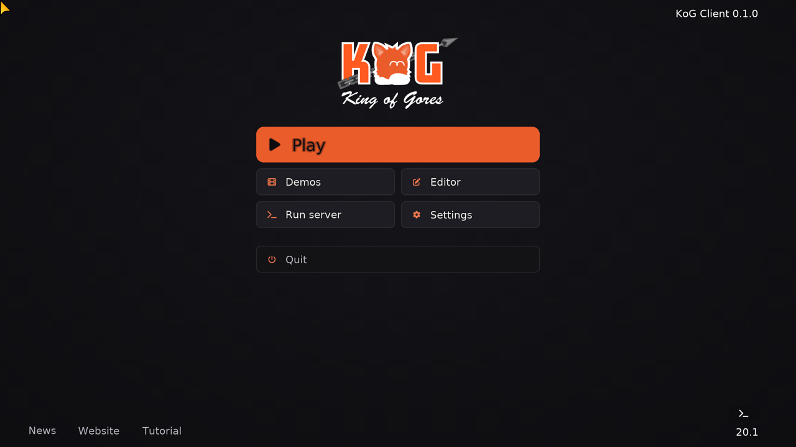 |
| 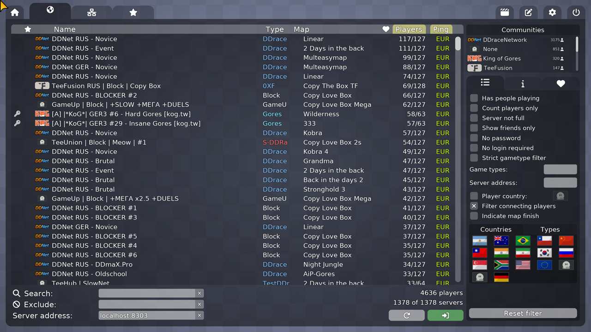 | 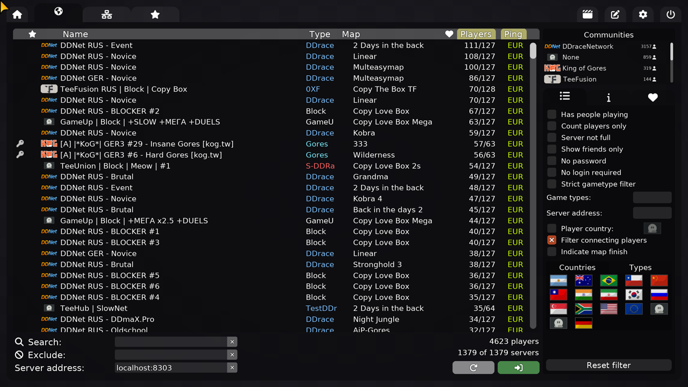 |
| 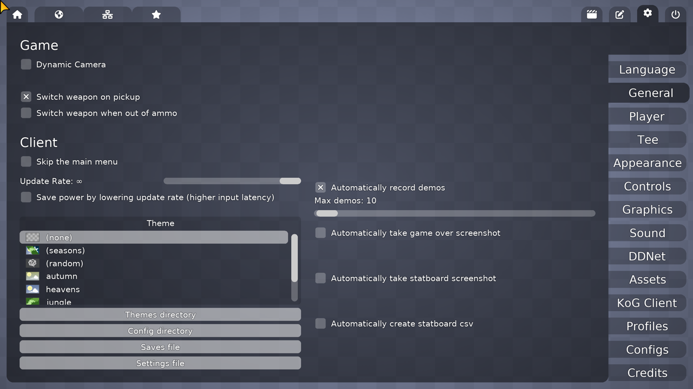 | 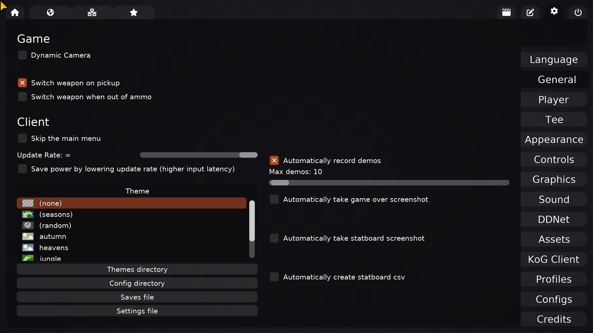 |

KoG light (the same pages):

| | |
| --- | --- |
| 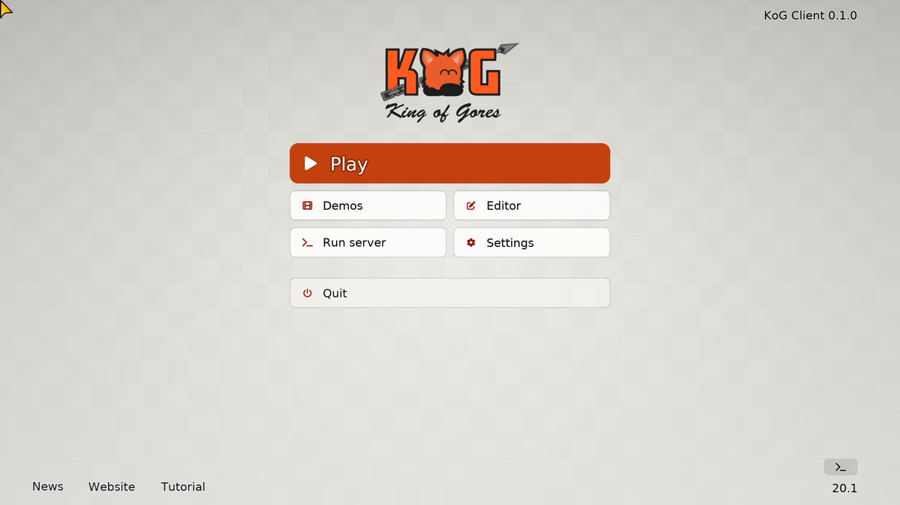 | 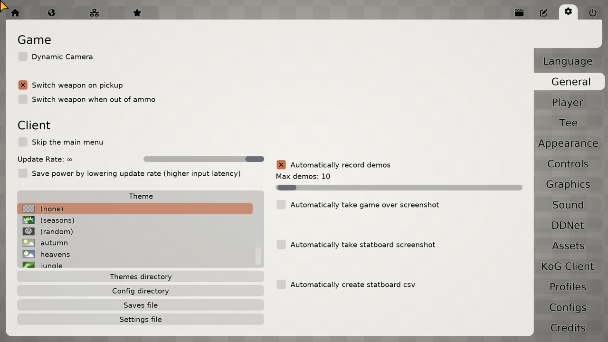 |

The server browser pair is like for like: same tab (Internet), empty filter, same machine, a minute apart (the lists differ
because the live server list changed).

Keyboard focus ring (Run server focused), 640x480, the quit popup and a notice toast (the toast was drawn by a local test hook over the
start page, in game it sits at the top of the game view):

| | |
| --- | --- |
| 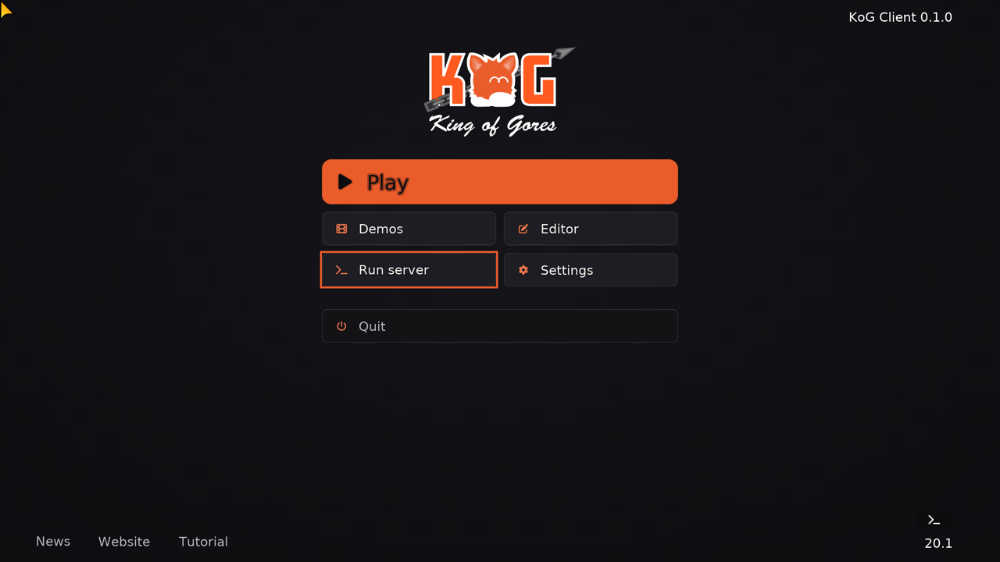 | 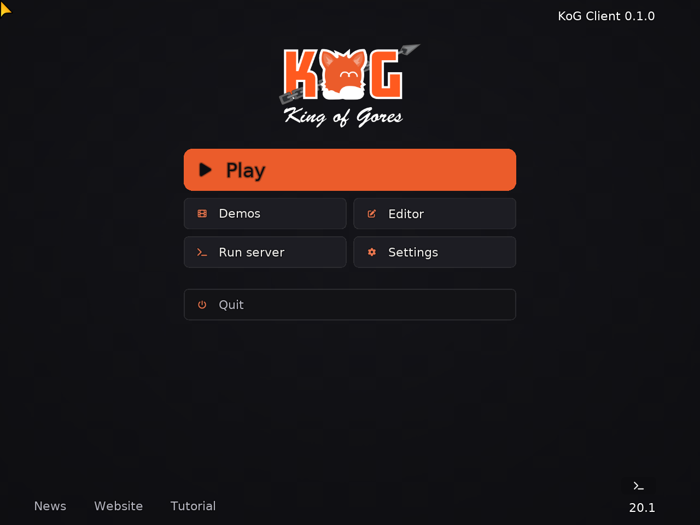 |
| 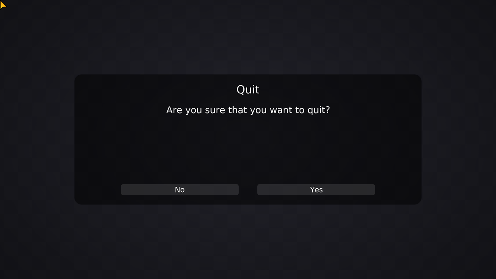 | 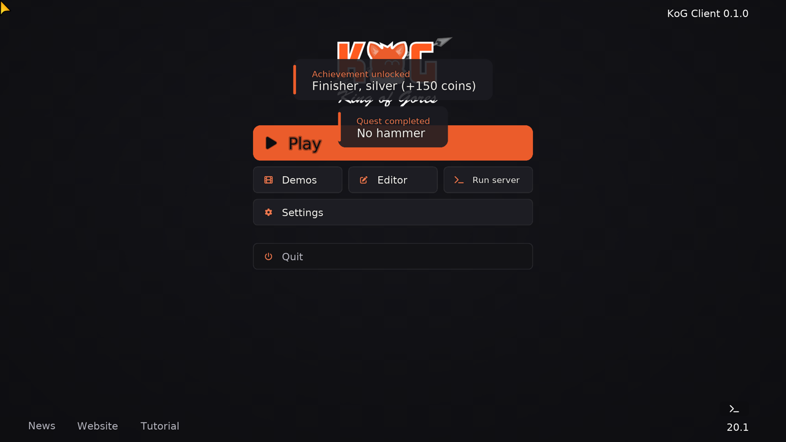 |

## 6. Fonts and icons

Icons: Font Awesome 6 Free Solid, already shipped (`data/fonts/Font_Awesome_6_Free-Solid-900.otf`, `FontIcon::`). Text: the
default font. A condensed heading font (Saira Condensed, SIL OFL) is **not** added: it has no CJK and the licence files
of the exact font binaries are not verified (`docs/MAIN-MENU.md`, question 5).

## 7. Performance

Measured with the client's own `benchmark_quit` (frame times written to a file), Release build, macOS, Apple M2 Pro,
1280x720 window, vsync off and no frame limit, menu map "auto" running, first 20% of the frames dropped, 20 s each:

| Page | Classic median / p95 | KoG dark median / p95 |
| --- | --- | --- |
| Start page | 337 / 1522 us (and 337 / 1567 in a second run) | 335 / 1568 us (and 349 / 1711 in a second run) |
| Settings, General | 521 / 1738 us | 524 / 1722 us |
| Server browser | 922 / 2225 us | 934 / 2264 us |

The difference is inside the run-to-run noise (about 3% on the median, 10% on p95): no regression found. Not measured on
other GPUs, with vsync, or on a low-end machine.

## 8. Layouts, languages, keyboard

- **Windows**: checked by screenshot at 1280x720 (16:9), 800x600 and 640x480 (4:3). The virtual screen is always 600 high, so
  the layout is identical at every 4:3 size; a tall window (width below 412 units) narrows the column (16 unit margins). UI
  scaling in this client is the window height; there is no separate scale setting to test.
- **Label length**: the start page buttons are two columns (about 136 units for text). `scripts/kog/check_label_lengths.py` reads
  `data/languages/*.txt` and reports labels that would shrink below 12 units. With the first design (three columns) it found 53
  cases (German "Server starten" at 9.6, French "Demarrer le serveur" at 7); with two columns it finds none. The model is
  rough (0.56 em per character); the real renderer measures with the font.
- **Keyboard**: on the start page Up, Down, Left and Right move a 2 unit brand outline in reading order, Enter presses the focused
  button (Enter without focus is still Play); the outline has 5.5:1 against the backdrop. Other pages keep the focus handling
  of the engine (list navigation), which is unchanged.
- **Not done**: Android touch (targets are 36 high, the 40 minimum is not met for the secondary buttons: open), right-to-left layouts.

## 9. The HUD: design C, built into the real components

The owner chose design C (compact, tabular) from three directions. A and B were never built into the components; the preview
scene that compared them is a local screenshot aid and is not in the repository.

**What it is.** Opaque panels (92%), radius 2, a brand header strip, zebra rows, your own row tinted with the brand colour,
12 unit text and 18 unit rows. All of it is named in `kog_style.h` (`Hud::`), applied through `kog_hud.h`, and a theme of
Classic returns every classic value, so the HUD is exactly upstream's.

**The minimum is enforced, not remembered.** `Hud::MIN_TEXT` is `Font::Caption` (12) and `Hud::MIN_ROW` is 18. Every text size and
row height of the HUD is listed in `Hud::TEXT_SIZES` and `Hud::ROW_HEIGHTS`; `kog_hud_test.cpp` fails on anything below the
minimum, on a minimum that drifts from the style's smallest text, and on a kill feed row that is below the minimum after the
conversion to its larger space (`KILL_FEED_SCALE` 3). Components pass their old literals through `KogHud::Text()` and
`KogHud::Row()`, which raise them to the minimum in the KoG look, so a literal that sneaks in below 12 is raised at run time too.

**The scoreboard no longer shrinks text to fit.** Upstream scales the font from 12 down to 5 units as players join (the
vanilla picture below shows 64 players at 5 units). In the KoG look `Hud::PlanScoreboard` picks the number of columns for the
screen instead, and what does not fit is counted ("+50 players not shown"), never drawn smaller:

| Players | 4:3 (800x600) | 16:9 (1067x600) | Test |
| --- | --- | --- | --- |
| 16 | 1 column | 1 column | `ScoreboardNeverShrinksTheTextToFit` |
| 64 | 3 columns, all shown | 3 columns, all shown | `SixtyFourPlayersFitOnEveryCommonScreen` |
| 128 | 3 columns, 78 shown, "+50 not shown" | 4 columns, 104 shown | `A128PlayerServerOnA43ScreenIsCountedNotShrunk` |

The tests run the plan on six screens (4:3, 16:9, 16:10, ultrawide, a narrow and a tall window), and check that the rows fit the
height, that a column keeps its minimum width, and that the plan never shows fewer players when there are more. Team games
(red and blue) keep the classic measurement for now: their layout has two scoreboards side by side and needs its own plan.

**Parts.** Scoreboard (panel, header, zebra, own row, headline and goals text raised to 12), kill feed (a pill per message sized
from the same widths the row is drawn with, row height 54 in its 3x space = 18 units, kept on screen), chat (line background and
text colour from the theme, font never below 12), tooltips (frame colour and radius), notice toasts (`CKogNotices`). All HUD
text uses `KogTheme::CMenuTextScope`, so the light theme has dark text and the game itself keeps white.

**Colour-blind safety.** Colour is never the only carrier: your row has a tint and a position (and the name), team rows keep the
team number as a label, ping is a number next to its colour, the kill feed shows weapon icons between names, server and quest lines
in the chat start with `***`. In the light theme the engine's ping and team colours are multiplied by the dark text colour and
become dark, so only the numbers remain: readable, not colourful (a known limit of drawing coloured text through the shared
text renderer; the numbers and labels carry the meaning).

**Measured** (the client's `benchmark_quit`, Release, macOS, Apple M2 Pro, 1280x720, no frame limit, 20 s, first 20% dropped; the
real components with a local fixture of fake players, chat lines and kills; the fixture and the screenshot hooks are not
in the repository):

| Scene | Classic median / p95 | Design C median / p95 |
| --- | --- | --- |
| Scoreboard, 64 players | 1764 / 4049 us | 2407 / 7228 us (dark), 2211 / 7733 us (light) |
| Scoreboard, 16 players | 765 / 2496 us | 822 / 4812 us |
| Chat and kill feed only | 1046 / 7967 us | 889 / 3873 us |
| One-player background (no real HUD) | 479 / 2665 us | |

The 64-player scoreboard costs about 0.6 ms more per frame at the median (3.6% of a 60 Hz frame): rows are the same count but the
text is 12 units instead of 5, so more pixels are drawn. The p95 is higher too. Labels are cached as before (the scoreboard
and the kill feed keep their text containers; the only new per-frame work is quads for the zebra and panels); I did not
profile where the 0.6 ms goes. A batching of the zebra quads is the first thing to try if it matters.

Screenshots of the real components (fixtures, vanilla look first):

| Classic, 16 players | Classic, 64 players |
| --- | --- |
| 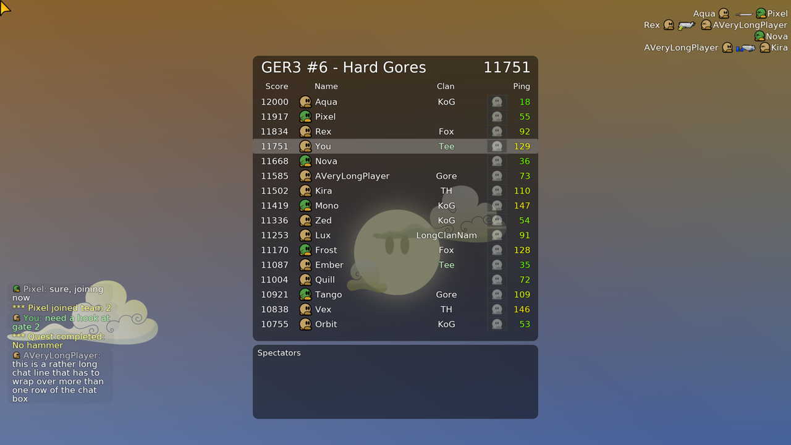 | 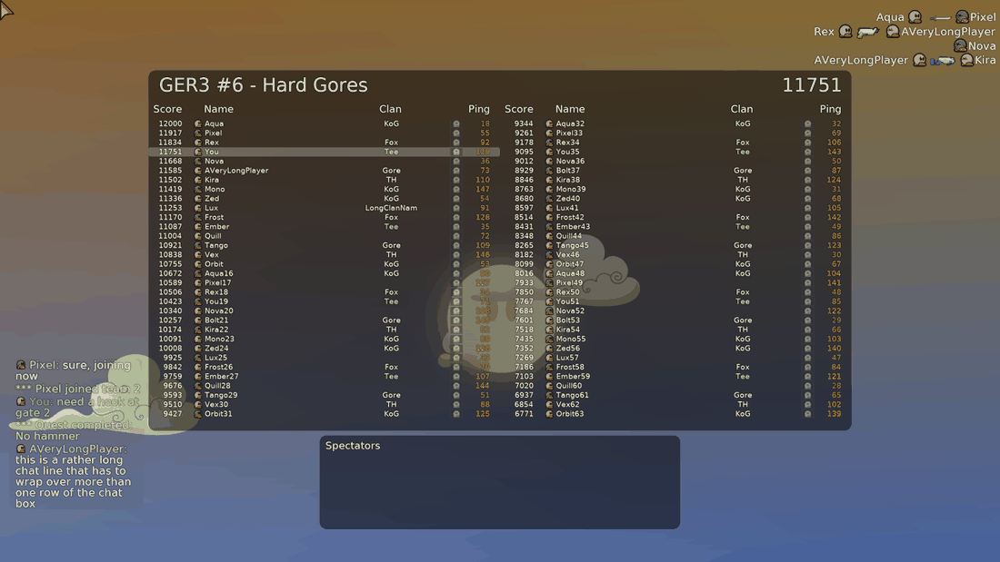 |
| Design C dark, 16 players, 16:9 | Design C light, 16 players, 16:9 |
| 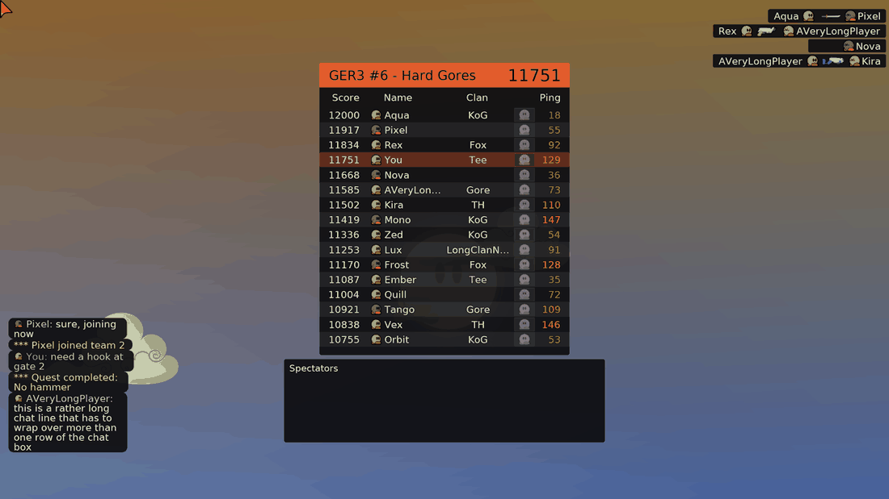 | 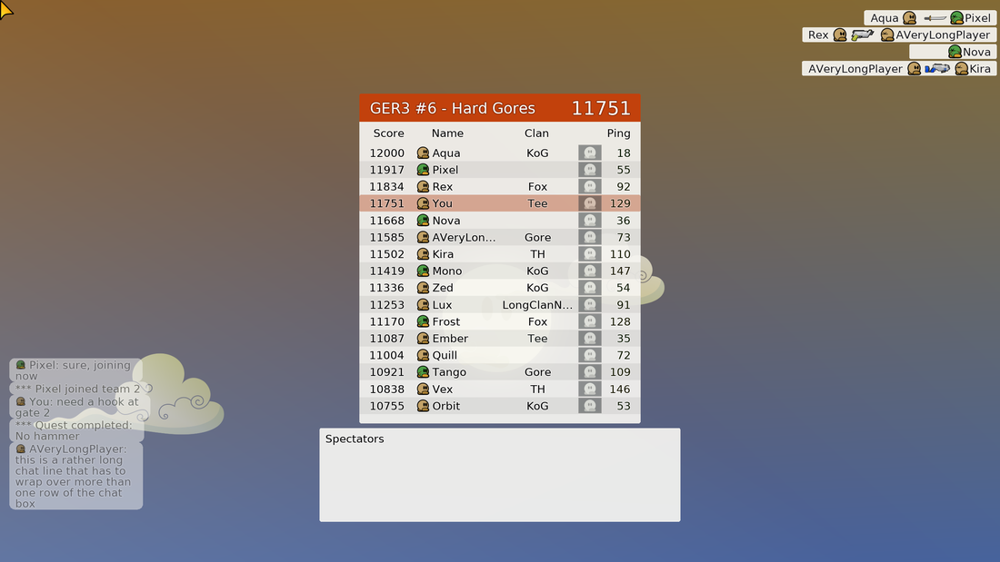 |
| Design C dark, 64 players, 16:9 | Design C light, 64 players, 4:3 |
| 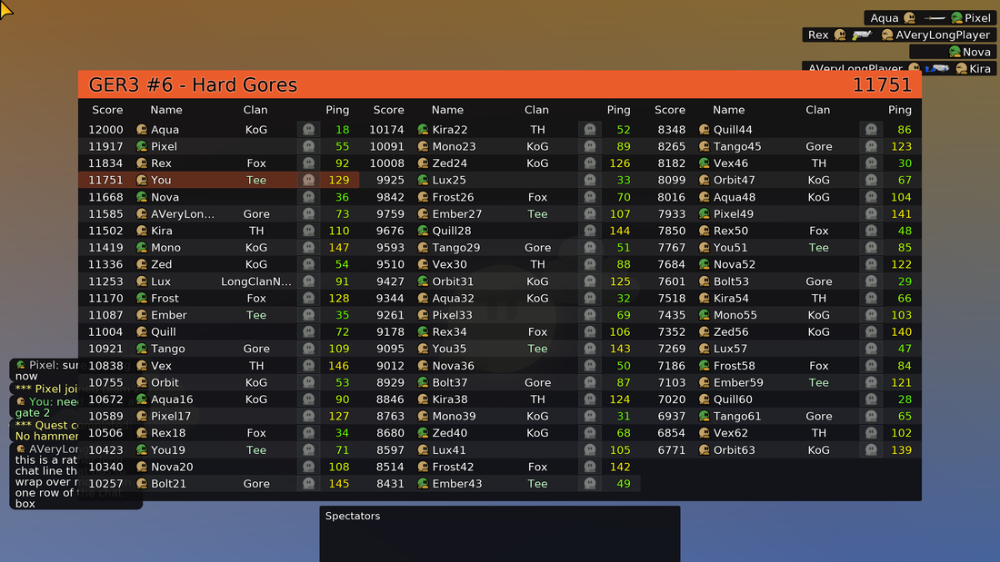 | 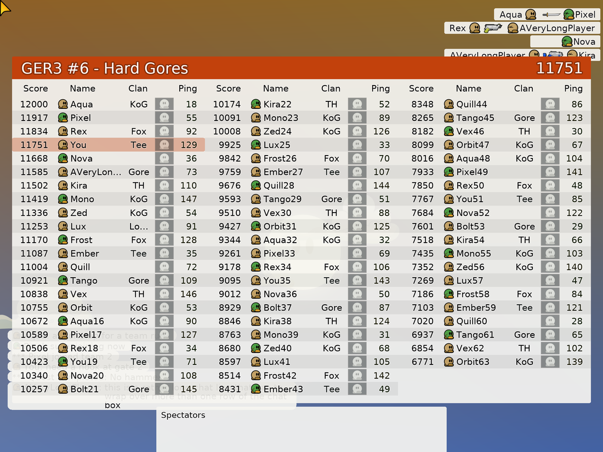 |

128 players on 4:3, never smaller than 12 units, with the count of the players that are not shown:

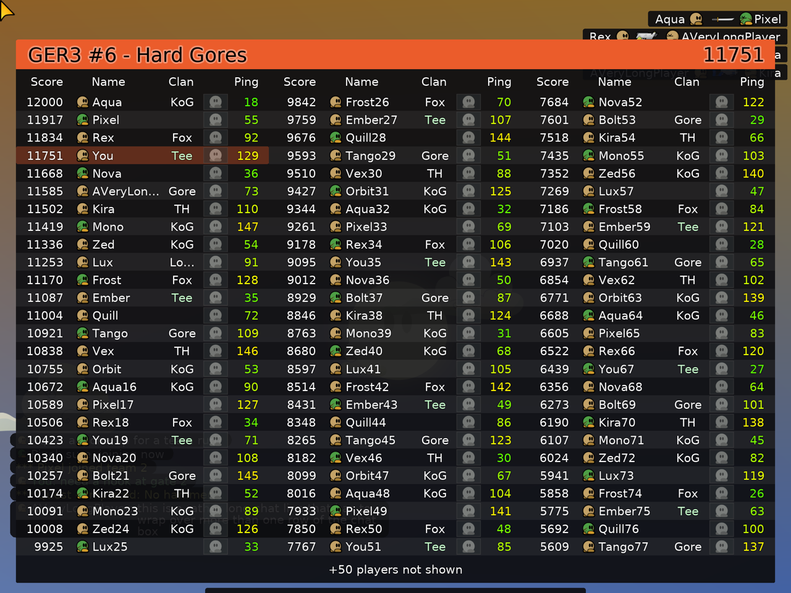

The tooltip frame and the notice toast were not captured from the real components in this series (the tooltip needs a hovered
control; the toast was shown with a test hook earlier).

**Long text.** Names and clans are cut with an ellipsis by the existing code ("AVeryLon..." in the pictures).
`scripts/kog/check_hud_label_lengths.py` reads `data/languages` and lists headline labels wider than their column at 12 units: 5
of them (Bosnian, Hungarian and Serbian "Score", Kyrgyz "Ping"), all right-aligned so they grow into the margin.

## 10. What is not done

Built since the first version of this page: the settings, popup and list colours follow the tokens through the shared helpers
(screenshots below), the toast for notices (`CKogNotices`, tokens only), the window and exe icons.

Not done: the scoreboard, chat, kill feed, notice and tooltip frame (three designs are compared in `designs/index.html`, not part of the repository; the owner picks one first), the rail and in-game frame of `MAIN-MENU.md`, a heading font (no font with a verified licence file is in the repository:
Saira Condensed is OFL on the websites but its files are not here).
