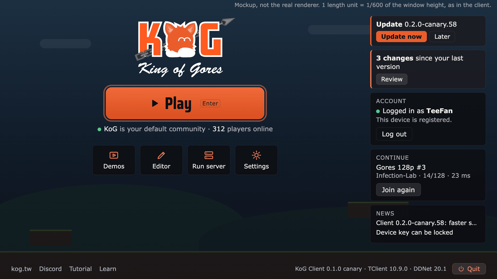
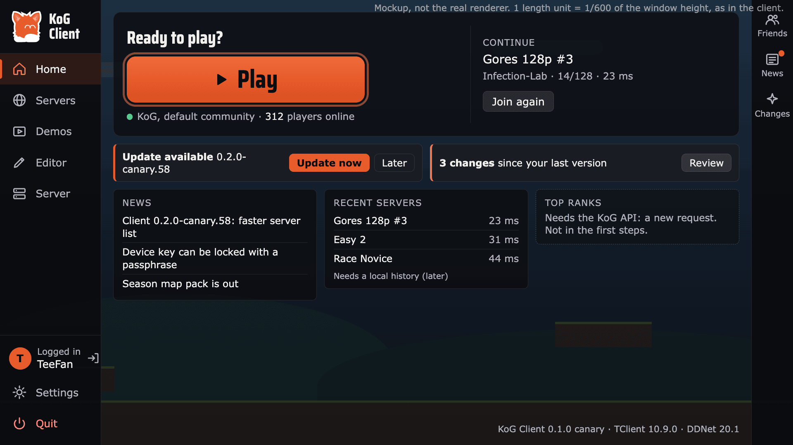
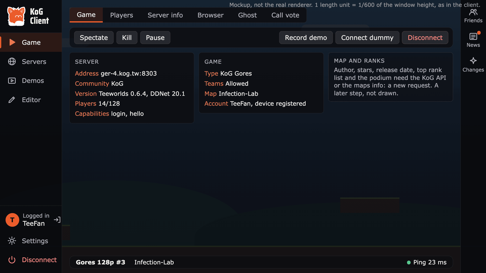
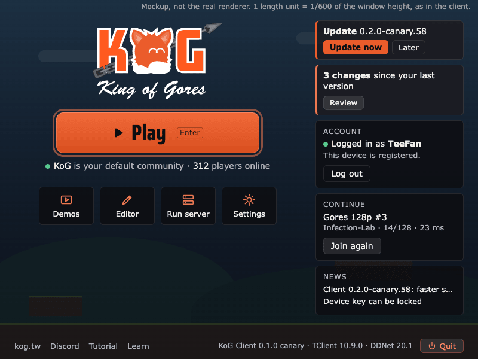
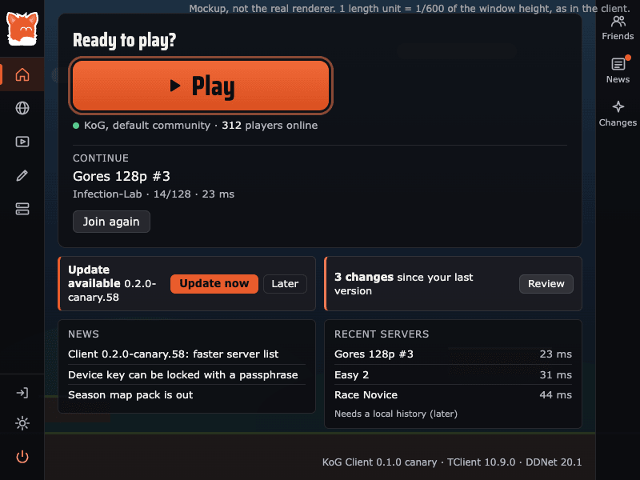

# Main menu: a modern start page, with cheap merges

Status: design, not built. No code in this change; only this page and the mockups in `docs/mainmenu-mockups/`.

Owner request: "entirely refactor the main menu and make it look more modern", later with a reference picture: a left
navigation rail, a narrow column on the right, tabs and action buttons on top, content as cards, a status bar at the bottom.
This page covers the main menu (start page) and the in-game menu (Esc while connected).

Read first: [PRIVACY.md](PRIVACY.md), [LOGIN.md](LOGIN.md), [UPDATE_CHANNEL.md](UPDATE_CHANNEL.md),
`docs/WHATS-CHANGED.md` (open PR #22), `CONTRIBUTING.md` ("Keep KoG code in new files (`kog_*`) and hooks in shared files small").

## 1. Goals and non-goals

Goals

1. Looks like the KoG family (kog.tw, client.kog.tw): dark surfaces, one orange accent, condensed headings, the official logo.
2. One calm start page: a big Play, the account state, what needs attention (update, "What changed"), the default community, the last server.
3. The same navigation on the start page, the server browser, demos, settings and in the in-game menu.
4. Costs nothing noticeable per frame (section 9) and works on small windows, in other languages and with keyboard or controller.
5. Upstream merges (TClient, DDNet) stay cheap: almost all new code in new files, a few hook lines in shared files, a kill switch.

Non-goals

- No new network request in steps 1 to 3 (section 6).
- No friends system, chat, ranks or avatars. The picture shows them; they need data or a backend we do not have (section 5).
- No rewrite of the server browser, demo browser or the 14 settings pages. They get the new colours and a new frame, nothing else.
- No light theme (the client has none; kog.tw's client site has one, the game UI does not). No new font in step 1.
- Not a new UI toolkit. The client's own immediate mode UI (`CUi`, `CUIRect`, `DoButton_Menu`) stays.

## 2. What the client does today

Read from `src/game/client/components/`; "Quit" and the other labels are the English source strings.

How a frame is built (`CMenus::Render`, `menus.cpp`): the UI draws on a virtual screen that is always **600 units high**;
the width is 600 times the aspect ratio. So 1920x1080 and 1280x720 give the same layout (1067 x 600 units); 800x600 gives
800 x 600. I found no UI scale setting: everything scales with the window height. A small window means small text, not a
different layout. All sizes in this page and in the mockups are in these units.

Offline, `Render()` draws the menu background (`CMenuBackground`, a map from `cl_menu_map`, default "auto" which picks a theme
by the time of day; the checker board when no map loads), then one of: a popup, the start page, or a page with the top bar.
`ui_color` (default hue purple-blue) tints all panels. There is no light theme.

### Start page (`menus_start.cpp`, 347 lines, class `CMenusStart`)

| Element | What it does | Keep / change |
| --- | --- | --- |
| Banner (`IMAGE_BANNER`, 360x103) | Logo at the top | Keep; official KoG logo (PR #26 already replaces the file) |
| Play (key P, Enter) | Opens the server browser on the last used tab | Keep, make it the big button |
| Demos (D) | Demo page | Keep, secondary |
| Editor (E) | Map editor | Keep, secondary |
| Run server / Stop server (R) | Starts a local server | Keep, secondary |
| Settings (S) | Settings page | Keep |
| Quit (Q, Esc) | Quit, with a popup if there is unsaved work or a running race | Keep, smaller, same rules |
| Left column: Discord, Learn, Tutorial, Website, News (N) | Links to **DDNet** (ddnet.org/discord, wiki.ddnet.org, ddnet.org), the Tutorial server, the news page | Change: KoG links (kog.tw, KoG Discord, KoG wiki if there is one); Tutorial stays; "Learn" only if it has KoG content. The KoG Discord address is not in the repository: the owner must give it |
| Bottom right: DDNet version, "KoG Client x.y.z", "(On Latest)" or "(Fetching Update Info)", console button | Version and TClient's update state | Keep one version line (client version, channel, based on TClient and DDNet); console button stays |
| Bottom: "Update now", "Restart", progress bar, "KoG Client %s is out!", "Update failed" | Update row (only with `CONF_AUTOUPDATE`); also opens the "Update required" dialog | Move into the update slot (section 4), same states, same dialog |
| `cl_show_start_menu_images` | Icons on the buttons | Keep working; the new page always has icons, so the setting only matters for the old menu |
| `cl_skip_start_menu` | Start directly in the browser | Keep, same meaning |

### Top bar (`CMenus::RenderMenubar`, `menus.cpp`) and pages

Offline: home button (a newspaper icon with a green tint when there is news or an update), big tabs Internet, LAN, Favorites
and one tab per favourite community (up to 5), then icons for Demos, Editor, Settings, Quit at the right. In game: tabs Game,
Players, Server info, Browser (the in-game network page), Ghost, Call vote, and the same icons. Pages:

| Page | File | Plan |
| --- | --- | --- |
| Server browser (tabs, filter, list, details, connect) | `menus_browser.cpp` | Unchanged; new colours and frame only |
| Demos | `menus_demo.cpp` | Unchanged |
| Settings, 14 tabs: Language, General, Player, Tee, Appearance, Controls, Graphics, Sound, DDNet, Assets, KoG Client, Profiles, Configs, Credits | `menus_settings*.cpp`, `tclient/menus_tclient.cpp` | Unchanged in steps 1 to 3 (section 12 asks about regrouping). The KoG account box lives in the "DDNet" tab (`RenderKogAccount`, `menus_settings_ddnet.cpp`) |
| News | `RenderNews` | Shows the `news` string of `info.ddnet.org/info`, which is DDNet's news, not ours. Keep the page; the start page does not show it by default (section 6) |
| In-game Game page (Spectate, Join game, Kill, Pause, Record demo, Connect dummy, Disconnect, console buttons) | `menus_ingame.cpp` | Unchanged; drawn inside the new frame |
| Popups: Welcome (first launch, language, nickname), Quit, Update, Disconnected, Password, Tutorial, Save skin ... | `menus.cpp` | Unchanged. Finding: the first launch popup still says "Welcome to DDNet" and talks about DDNet servers; it needs KoG text (small separate change) |
| Loading screen (`RenderLoading`) | `menus.cpp` | Unchanged; may take the new colours |

TClient adds the "KoG Client" settings tab, profiles and configs pages and `m_TClient.NeedUpdate()`. KoG adds
`CKogLogin` (account state, `HasDeviceKey()`, `Busy()`, `Message()`, `cl_kog_account_name`), `CKogHello`, the update dialog
(`ShowUpdateDialog`) and, in PR #25, the default community KoG (`kog_community.h`, `KogCommunity::ID`).

### Before screenshot

I built the client from `main` (macOS, release, `-DCLIENT=ON -DSERVER=OFF`) and it starts and runs. I could **not** take a
screenshot of it: `screencapture` fails with "could not create image from display" in this session, and the client's
`cl_input_fifo` did not deliver a `screenshot` command. So there is no "before" picture; the table above is the description.
The shape of today's start page, from the code: logo at the top centre; a 380 wide column in the middle with six buttons
(Play, Demos, Editor, Run server, Settings, Quit) from the bottom up; five small text buttons at the left; version lines at the
right bottom; the update row at the bottom.

## 3. Merge cost against freshness: the recommendation

The question: `menus_start.cpp`, `RenderMenubar` and the pages are shared with TClient and DDNet. Editing them in place makes
every upstream merge a conflict. How much is that? Non-merge upstream commits on `master` since 2025-11-01 (the mirror of
TClient): `menus_start.cpp` 5, `menus.cpp` 26, `menus_browser.cpp` 28, `menus_settings.cpp` 44. The start page changes rarely;
the pages around it change all the time.

| | Shared files touched | Lines in shared files | Conflict risk |
| --- | --- | --- | --- |
| A. New start page in new files, behind a setting | `menus.cpp`, `menus.h`, `CMakeLists.txt` | about 20 | Hook lines only. `menus_start.cpp` stays byte-identical to upstream |
| B. In-place rewrite of start page and bar | `menus_start.cpp` (347 lines rewritten), `menus.cpp` (`RenderMenubar` about 230 lines), `menus.h` | 600 and more | Every upstream commit on those files conflicts (31 in the last year); the old menu and a kill switch are gone |
| C. Hybrid: A, plus a rail and tokens drawn from KoG files, plus one flag in `RenderMenubar` | the same three files, plus about 12 lines inside `RenderMenubar` | about 35 | The flag is the only edit inside a churning function; each `if(!m_KogRail)` wrap is one line |

**Recommendation: C, built in the order A first.** Reasons: (1) the kill switch `cl_kog_menu` falls through to the untouched
upstream code, so OFF is exactly the old menu and the old path stays tested by upstream; (2) a rewrite in place loses that and
costs a conflict for every upstream change to a file that changes about every second week; (3) the rail from the owner's
picture needs the top bar's browser tabs (Internet, LAN, Favorites, communities) to stay, which is upstream logic with about
90 lines of favourite community handling; copying it would drift, a flag that hides the icons the rail replaces does not.

Expected shared-file edits, per step:

| Step | `menus.cpp` | `menus.h` | `CMakeLists.txt` | Other shared |
| --- | --- | --- | --- | --- |
| 1 start page | in `Render()`: `else if(m_ShowStart)` gets a `KogMenuOn()` branch (3 lines); `OnInterfacesInit` (1 line) | include and member `CKogMenu m_KogMenu` (3 lines) | 4 lines in the existing KoG block | none; `cl_kog_menu` goes in `config_variables_kog.h` (a KoG file) |
| 2 slots | none | none | 0 | none |
| 3 rail and tokens | in `Render()`: shrink `MainView` by the rail for offline and in game (2 x 3 lines), set the `ms_Color*` tokens when on (4 lines); in `RenderMenubar`: `if(!m_KogRail)` around the home, demo, editor, settings, quit buttons (about 12 lines) | `m_KogRail` flag (1 line) | 2 lines | none |

The pages draw into the `MainView` they are given, so a rail is a smaller `MainView`; no page file changes. Risk: a page
that is too wide for a narrow window (the server browser needs about 700 units). The rail is 136 units wide, 56 on 4:3
(mockups), and the right strip is hidden below 900 units width, which leaves 744 on 800x600. Each page must be looked at on
800x600 before step 3 is merged.

Which look: **Variant B (rail and cards, the owner's picture) is the target**, **Variant A (centred hero, side column)** is the
fallback if a page does not fit next to a rail. Both share the same home content (section 4), so step 1 and 2 do not decide it:
step 1 can start with A's layout inside the old top bar, and step 3 adds the rail.

## 4. Information architecture and the start page

Navigation (rail, in this order; keys keep today's hotkeys):

| Item | Goes to | Key |
| --- | --- | --- |
| Home | Start page (not offered while connected) | Esc from a page (as today) |
| Servers | Server browser; tabs Internet, LAN, Favorites, communities stay on the page | P, Enter on Home |
| Demos | Demo page | D |
| Editor | Editor | E |
| Server | Run or stop the local server | R |
| (bottom) Account | "Logged in as X" with a log out icon, or "Log in with KoG"; opens Settings, KoG account | none |
| (bottom) Settings | Settings | S |
| (bottom) Quit | Quit with the same popup rules | Q |

In game the rail shows Game, Servers, Demos, Editor, Settings, Account and Disconnect instead of Quit; the tab strip is
today's (Game, Players, Server info, Browser, Ghost, Call vote) and the buttons are today's. The picture's "Explore" has no
counterpart, so it is left out. News and "What changed" are buttons in the right strip (below).

The start page, from top to bottom in Variant B (Variant A has the same content in a column at the right):

1. Play: a large button, the community line below it ("KoG, default community, 312 players online"). Play opens the KoG
   tab of the server browser with the best row selected; Enter joins it. Nothing connects without a visible choice. A one click
   "quick join to a chosen server" is open question 3.
2. Continue: the last server the player joined (`ui_server_address`, already saved) with name, map, players and ping if the
   server is in the loaded list, else only the address. "Join again" connects.
3. Slots, shown only when they have something to say: Update (states of `Updater()`: available, downloading with the existing
   progress bar, restart needed, failed, required) and "What changed" ("N changes since your last version", Review; the page of
   PR #22, banner exactly as that design says: it never opens by itself and never shows in game).
4. Cards: News (section 6), Account (variant A), Recent servers (needs a local history, later), Top ranks (later, needs the API).
5. Footer: one version line ("KoG Client 0.1.0 canary, TClient 10.9.0, DDNet 20.1") and the console button.

Account card states (read from `CKogLogin`, no new request): off (`cl_kog_login 0`: card hidden, `/login` still works);
logged out ("Log in with KoG", the existing browser flow); busy (the step message); logged in ("Logged in as <name>",
"This device is registered"); error (the message in red, "Try again"); key file locked or damaged (after PR #21 lands:
"Unlock" or "Create a new key"; today: the existing error text). Log out keeps today's behaviour (wipes the key at once).

The capability hello (`CKogHello`) has no menu of its own; it is a connection thing. The in-game Server card shows what was
negotiated (`Negotiated()`), which helps testing. It never shows before a server answered.

## 5. The reference picture, element by element

| Element in the picture | Our data | Verdict |
| --- | --- | --- |
| Rail: logo, Home, Servers, Editor, Demos | all exist | Do (step 3). Explore: no counterpart, skip |
| Account block, "Logged as", log in or out icon | `CKogLogin`, `cl_kog_account_name` | Do (step 2) |
| Settings below the account | exists | Do |
| Right column: friends online, avatars | The client has a local friend list (names). Online counts would have to come from the loaded server list, which only knows players of servers it has queried; no avatars (tee skins could be drawn, but only after a join) | Later, optional, step 5. No request. Not drawn as working in the first steps; the strip only has Friends if the count comes from data already in memory |
| "1 new" chat and news buttons | Game chat is in the game, not the menu. News exists (section 6) | News and "What changed" buttons: do. Chat: no |
| Tab strip Game, Maps, Call Vote, Players, Ghost | Game, Players, Server info, Browser, Ghost, Call vote exist; "Maps" does not | Do with our tabs |
| Action row: Spectate, Kill, Pause, Instant Replay, Record Demo, Dummy, Disconnect | all but Instant Replay exist (`menus_ingame.cpp`) | Do, restyled |
| Server card: address, version, community | `CServerInfo` | Do |
| Game card: type, players, teams | `CServerInfo` | Do |
| Map card: author, stars, points, release date, finishes, preview image | The client only has the map name and, for DDNet communities, finish state. Author, stars, release date, counts and the preview image come from the DDNet map info or a KoG endpoint | Out of scope now. Later step needs a request (named in section 6) |
| Top Rank podium and list, filters Global, Country, Region | Needs ranks from the KoG API | Out of scope now; later step with an explicit opt-in or at least a documented request. Drawn as a dashed placeholder, not as a feature |
| Status bar: server, map, stars, top time, ping | server, map, players, ping exist; stars and top time do not | Do server, map, ping |
| Darkened, softly blurred background | see below | Do darkened, not blurred |

**Blur.** DDNet's UI draws quads, text and textures; there is no blur pass and a full screen blur every frame is exactly
what the owner does not want. What the client can do cheaply: (1) `CMenuBackground` already draws the menu map; put one
full-screen quad over it with vertex colours (darker at the top and bottom, a few percent of the accent in a corner): two
triangles, no texture; (2) panels as rounded rectangles of black at 80 to 88 percent alpha, which makes the map behind them
quiet enough without any blur; (3) for a softer look, a pre-blurred still image per theme as a texture is possible, but the
menu map moves and the themes are user supplied, so it would be a different background, not a blurred one. I recommend (1)
and (2). In game there is no menu map: the game world is behind the menu, and the same scrim applies.
The mockups use exactly this: a gradient over a map stand-in and translucent panels.

## 6. Data sources and the privacy statement

**Steps 1 to 3 add no network request.** Everything on the start page comes from what the client already holds:

| Shown | Source | Request |
| --- | --- | --- |
| Community, players online | `ServerBrowser()->Community(KogCommunity::ID)->NumPlayers()`, filled from the server list | The server list, already fetched at start (`master1..4.ddnet.org`, `info.ddnet.org`, see PRIVACY.md) |
| Continue | `ui_server_address` and the server list | none |
| Update slot | `Updater()` state and `GetUpdateInfo` (version, channel, size, changes, notes URL) | The signed manifest at `client.kog.tw/<channel>/update.json`, already fetched at start when `kog_check_updates` is 1 |
| What changed | the table compiled into the client (PR #22) | none |
| Account | `CKogLogin`, config | none until the player presses Log in or Log out |
| News card | The `changes` and the notes URL of the manifest above, so the card is "what is new in this release". DDNet's own `news` string (`info.ddnet.org`) stays on the News page only | none beyond the two rows above |
| Version line | compile time constants | none |

There is no KoG news source today. If the owner wants announcements (events, maintenance) in the card, the least costly way
is a field in the same signed manifest, so it is signed, comes from the host that is already contacted and needs no new
endpoint. A separate endpoint would be a new connection and needs its own row in PRIVACY.md first.

Later steps, each needs its own design and PRIVACY.md row before it is built: ranks and map info from the KoG API (the request
would carry the map name and, for a personal rank, the account name; only after opt-in), a local recent server history (local
only; stored in the config, never sent), friends online (local list, data already in memory, no request).

Offline: the update row shows nothing (as today, "no connection" is only a log line); the community line says "Server list
not loaded. Play opens it and retries" (mockup `variant-a-offline`); the account card still works offline in the sense that the
state is local, the login button fails with the existing message; Continue shows the address and "no ping yet".

## 7. Visual language

Taken from `kog-www/resources/css/app.css` (the "timing board" tokens) and `client.kog.tw` (`site/assets/style.css`); the same
values, so the client feels like the same family.

| Token | Value | Use |
| --- | --- | --- |
| `bg` | `#0d0d10` | Base, behind panels |
| `panel` | `#0d0d10` at 80 percent | Cards, rail (rail 88 percent) |
| `panel2` | `#1b1b21` at 88 percent | Slots, raised cards |
| `line` | white at 10 percent | 1 pixel borders (two thin quads or an outline rounded rect) |
| `fg` | `#f1f0ec` | Text (15 to 1 on `bg`) |
| `muted` | `#b4b4be` | Secondary text; contrast is kept above 4.5 to 1 on `panel` even over a bright map |
| `brand` | `#eb5c2b` | Play, focus bar, active item, primary buttons (text `#0d0d10` on it) |
| `brand-soft` | `#ed784f` | Icons, small accents |
| `ok`, `warn`, `err` | green `#58c98f`, amber `#f2b84b`, red `#ff8a8a` | State dots, Quit, errors |

Colour is never the only carrier: a state has a word as well (the account dot has "Logged in as"). The tokens are one struct
in a `kog_menu_theme.h`. In step 3 the existing `ms_ColorTabbar*` values are set from the same tokens when `cl_kog_menu` is on,
so the server browser and settings take the new look without edits. `ui_color` no longer tints the KoG menu: one value less
for the player to tune (this is the "fewer values" rule); open question 6 asks whether to keep it as an accent.

Spacing scale (units): 4, 8, 12, 16, 24, 40. Radius: 6 for buttons and cards, 10 for the hero panel and Play. Type scale:
12 (labels, the smallest allowed), 14 (body), 16, 22 (card title), 34 (Play). Rows are at least 28 high; rail items 42.
Icons: Font Awesome 6 Free Solid, which the client already loads as its icon font (`FontIcon::*`, used in `RenderMenubar`);
the mockups use simple stand-in drawings of the same meaning. No new image files except the logo (PR #26).
Logo: official files from brand_and_media, unmodified (CC BY-NC-ND 4.0). The rail uses the short logo, the hero page the long
one; nothing recoloured, cropped or placed on a background that hurts its outline.

Headings: Saira Condensed 700 on the websites. The client's font mechanism (`data/fonts/index.json`) can load more fonts but a
font that is shipped needs its licence checked (NOTICE_KOG.md already lists fonts as unverified). Saira is under the SIL Open
Font License, but I did not verify the exact files. Step 1 uses the client's default font; adding Saira Condensed for headings is
open question 5. The mockups embed it to show the intent.

Motion: hover and focus colour changes over 100 ms, using the existing `SUIAnimator` (the top bar does the same). No looping
animation on the start page (the menu map already moves). The fade is skipped when `ui_smooth_scroll_time` is 0, which is the
existing "less motion" setting, so there is no new "reduce motion" value.

## 8. Behaviour

Responsive. Layout is computed from the unit size, not pixels. At 16:9 (1067 wide) the rail is 136 wide, the cards are in
three columns and the right strip shows. At 4:3 and narrower than 900 units, the rail shrinks to icons (56), the strip
is hidden or kept at 56, the hero stacks and the third card column drops (mockups at 800x600). Below 4:3 (a tall window)
cards stack in one column and the page scrolls with the existing `CScrollRegion`. Windows smaller than about 640x480 are not
a target: text is below 10 pixels there already today.

Text size and other languages. Labels use at least 12 units. Every button label is measured with
`TextRender()->TextWidth()`; if it does not fit, the font shrinks down to 12, then the label is cut with the existing
`m_MaxWidth` handling and the full text is a tooltip. Slots wrap to two lines. German, Russian and French strings run 30 to
50 percent longer than English: the layout is tested against them (section 11). All strings go through `Localize()` with a
context where the word is ambiguous (`Localize("Play", "Start menu")` exists). Numbers and names are never part of a
translated string except through format arguments.

Keyboard and controller. Today the start page has hotkeys (P, D, E, R, S, Q, N, Enter, Esc) and the mouse; a controller
drives the mouse cursor (`ui_controller_sens`). The new page keeps every hotkey and adds Up and Down to move a focus ring over
the rail, Left and Right across the slots, Enter to activate, Esc to leave a page or open the Quit popup. The focus ring is
drawn (an orange outline, mockup A shows it on Play) so keyboard and controller users see where they are. Focus is our own
index, the generic `CUi` has no focus order. Touch (Android build): hit areas are at least 40 units (about 70 px at 1080p).

Menu background. Unchanged: `cl_menu_map` and the themes. `CMenuBackground::ChangePosition(POS_START)` is still called for
the start page and the other `POS_*` for pages. A fixed scrim is added over it (section 5). With no map the existing checker
board shows, which looks fine under the panels.

Edge cases:

| Case | Behaviour |
| --- | --- |
| First start | The existing Welcome/language/nickname popup comes first and covers the page; the default community (PR #25) is picked as today; no "Continue", no "What changed" slot (the PR #22 rule), account card shows "Log in with KoG" as optional |
| No network | See section 6; Play works, the browser shows its own error |
| Login off (stable build default) | No account card, no rail account block |
| Key file locked or damaged | Account card shows the state and the one action; never blocks Play |
| Update in progress | The update slot shows the existing progress bar; Play stays enabled; Quit warns as today (the updater restores files if interrupted) |
| Update required (below minimum) | The existing modal dialog stays; the slot repeats it in red |
| Small window | Section 8, responsive |
| Local server running | The Server item reads "Stop server" and has a green dot (as the old button turns green) |
| Unsaved editor data | Editor item has a dot; Quit asks, as today |
| Headless or dedicated start | Nothing is drawn; no change |

## 9. Performance budget

The owner complained about lag on the website; the menu must not repeat that.

- The start page draws at most about 150 quads and 30 text labels. No texture other than the logo and the icon font.
- No full-screen blur, no render to texture, no per-frame loops over the server list: players online come from
  `CCommunity::NumPlayers()` (precomputed by the browser); a server count, if wanted, is cached and recomputed when
  `NumServers()` changes, at most once a second.
- No heap allocation in the render path of our code: `char` buffers on the stack, `static CButtonContainer` as today. The text
  engine caches containers itself; I did not measure it, so step 1 includes a measurement (frame time of the start page with
  and without `cl_kog_menu`, on the menu map and on the checker board).
- The animation cost is the hover fade only.
- Acceptance: the new start page costs no more than 10 percent over the old one in the frame time measurement, and
  `cl_menu_map ""` stays the cheap path. If not, the page is simplified, not the budget.

## 10. Kill switch

`cl_kog_menu` (0 or 1, saved), per the repository rule that every feature has one. Default on in canary and dev builds (a
compile time default like `KOG_LOGIN_DEFAULT`), **off in stable until step 4**. OFF means: the upstream start page and top
bar, exactly (the hook falls through to `m_MenusStart.RenderStartMenu` and `RenderMenubar` with `m_KogRail` false); nothing
else changes; the saved page, community and settings stay. The setting can be changed in the settings page (General) and by
console; a change takes effect on the next frame (no restart). The setting itself is shown nowhere on the start page.

Interplay: with it ON the "What changed" banner and the update slot are drawn by us; with it OFF, "What changed" still
works through its own switch `cl_kog_changes_page` and PR #22's fallback (a line on the old start page: that fallback is
part of step 2, so PR #22's page does not depend on this one).

## 11. Tests and how to check visually

Unit tests (new, `src/test/kog_menu_layout_test.cpp`): the layout is a pure function in `kog_menu_layout.h` (screen width and
height in units, which slots are shown, rail mode, a text width callback) that returns rectangles. Tests: no rectangle leaves
the screen at 800x600, 1067x600, 1600x600 (ultra wide) and 450x600 (tall); no overlaps between siblings; the rail turns compact
below the limit; cards drop in the stated order; Play is at least 40 units high; every label fits or is marked cut, with
a fake text width of 0.55 em per character on the longest translation of each new string (read from `data/languages`).
Also: the default of `cl_kog_menu` per channel, and that OFF takes the old branch (`KogMenuOn()` is a function of the config
only, so it is testable).

Screenshots. The client has a `screenshot` console command (F10) and `cl_input_fifo`; `scripts/kog/smoke_test.sh` already
starts the Linux client under Xvfb with software OpenGL and drives it through that fifo. Step 1 adds
`scripts/kog/menu_screenshots.sh` that does the same for three window sizes and a few config states (logged in, logged out,
update available) and stores the PNGs as a CI artifact; it is a review aid, not a pass or fail test. In this session the same
on macOS failed (section 2), so I have not verified that route; it is the first thing step 1 proves. There is also
`HEADLESS_CLIENT` in CMake, but that build has no graphics. Until then: compile, run and look.

The HTML mockups are checked into `docs/mainmenu-mockups/`; they are not a test.

## 12. Rollout in small pull requests

1. Skeleton and start page behind `cl_kog_menu`: `kog_menu_theme.h`, `kog_menu_layout.h` and test, `kog_menu_start.cpp/.h`
   (Variant A's page, inside the old top bar), the hook lines, the screenshot script, the frame time measurement. Default on in
   canary and dev, off in stable.
2. Slots: account, update (moved from the old page), "What changed" (needs PR #22), community line, Continue, links to KoG.
3. Rail, tokens and the in-game frame (`m_KogRail`, `ms_Color*`), page checks at 800x600, polish; right strip with News and
   Changes (Friends only if the data is in memory).
4. Stable decision: default on in stable after two canary releases without a menu bug report, or it stays off.
5. Optional, each needs its own design: Saira Condensed headings, recent servers, friends, ranks and map info from the KoG API.

## 13. Open questions, each with a recommendation

1. **Which variant?** Recommend B (rail) as the target, built as C: start with A's page content inside the old bar (steps 1
   and 2), add the rail in step 3. If a page does not fit beside the rail at 4:3, keep A for that case.
2. **Edit `menus_start.cpp` in place?** No. New files and hook lines (section 3).
3. **Play: open the browser or join at once?** Recommend: open the KoG tab with the best row selected, Enter joins. A silent
   join to a server the client picked is a policy for the server team to define (which server, which ping limit) and the list
   may not be pinged yet; revisit after step 2 with the real ping data.
4. **News source?** Recommend: release changes from the signed manifest only; announcements as a field of that manifest if
   wanted; no new endpoint without a PRIVACY.md row.
5. **Saira Condensed in the client?** Recommend: not in step 1; decide after the licence check of the font files and the
   cost for the font loader and the languages (Saira has no CJK). The default font works.
6. **Keep `ui_color`?** Recommend: no for the KoG menu (fixed palette, one value less); the old menu keeps it when
   `cl_kog_menu` is 0.
7. **Stable default?** Recommend off until step 4, then on after two canary releases.
8. **Regroup the 14 settings tabs?** Recommend not in this series: `menus_settings.cpp` is the most edited upstream file (44
   commits in a year). A grouped overview as a separate KoG page can come later, without editing the tab array.
9. **Friends and ranks (from the picture)?** Recommend: later and optional; they need data or a backend we do not have. Friends
   from the local list are cheap; ranks need the KoG API and a privacy row.
10. **Links in the start page** (Discord, Learn, Website) point at DDNet today. Recommend: the KoG site now; the owner supplies
    the KoG Discord address.
11. **Welcome popup says "Welcome to DDNet".** Recommend: a small separate text fix, not part of this series.

## Mockups

Static HTML and CSS in `docs/mainmenu-mockups/`, standalone (the logos and the heading font are embedded; the logos are the
unmodified official SVG files). They are **not the real renderer**: the client draws quads and text, so no CSS blur, no soft
shadows and no per-pixel effects were used beyond what it can do (rounded rectangles, vertex colour gradients, text, a few
textures); the map behind is a rough stand-in. The page scales with the window height like the client (1 length unit is one
600th of the height), so you can open an HTML file and resize the window. Dark theme only.

| Page | 1920x1080 | 1280x720 | 800x600 |
| --- | --- | --- | --- |
| Variant A, start page (all slots filled) | `variant-a-1920.png` | `variant-a-1280.png` | `variant-a-800.png` |
| Variant A, offline and logged out | | `variant-a-offline-1280.png` | `variant-a-offline-800.png` |
| Variant B, start page (rail, cards) | `variant-b-1920.png` | `variant-b-1280.png` | `variant-b-800.png` |
| Variant B, in-game menu | `variant-b-ingame-1920.png` | `variant-b-ingame-1280.png` | `variant-b-ingame-800.png` |

The embedded logos are the official files from brand_and_media (commit pinned by PR #26), CC BY-NC-ND 4.0, not under the zlib licence of the rest. The embedded heading font is Saira Condensed 700 from the kog-www public folder.

Names and numbers in the mockups (TeeFan, 312 players, the servers) are made up. The Friends strip, Recent servers and
Top ranks are drawn to show the idea; section 5 says which of them are out of scope.
